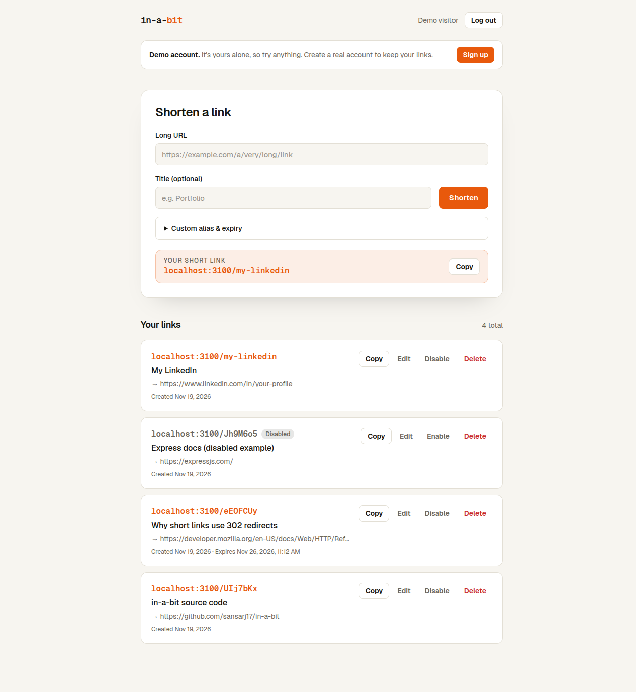
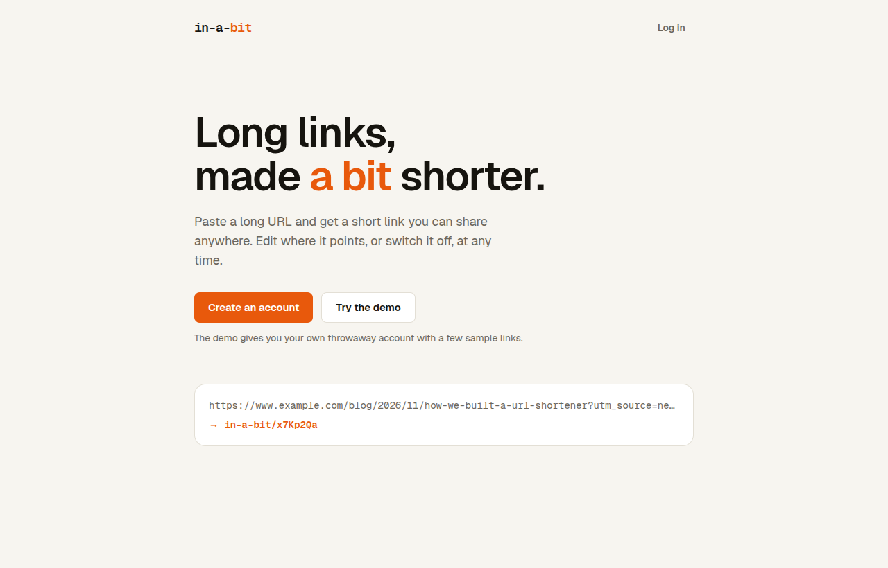
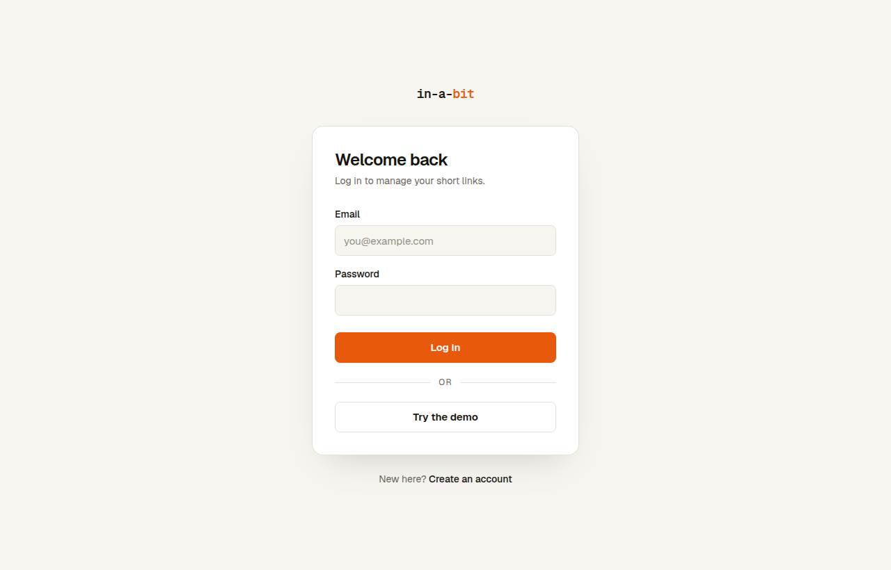

# in-a-bit

[](https://github.com/sansarj17/in-a-bit/actions/workflows/ci.yml)

A URL shortener: sign in, paste a long URL, get a short link that redirects to it.

- Short links with random codes or a custom alias (`/my-cv`), optional expiry date
- Edit where a link points, switch it off, or delete it
- One-click demo account with sample links, no sign-up needed
- Accounts with hashed passwords and an httpOnly JWT cookie
- Rate limits, security headers and URL checks (http/https only, no links back to itself)



<p>
  
  
</p>

```
in-a-bit/
├── backend-node/        # Express 5 + TypeScript API (Prisma, PostgreSQL), Dockerfile
├── frontend/            # Next.js 16 (Pages Router) + React 19
├── docker-compose.yml   # Local Postgres
├── .github/workflows/   # CI: typecheck, lint, build, Docker image
└── docs/
    ├── PLAN.md          # Scope, architecture, design decisions
    ├── API-ORIGIN-LOCK.md # Why only the frontend can call the API, and how
    └── screenshots/
```

```
Browser ──► Next.js (:3000) ── /api/* rewrite ──► Express (:8080) ──► PostgreSQL (:5433)
```

The browser only ever talks to the frontend's origin; Next.js forwards `/api/*` to the
backend, so the auth cookie is first-party and no CORS setup is needed in the browser.

## Prerequisites

- Node.js 24+, pnpm 10
- Docker (for Postgres)

## Getting started

```bash
# 1. Database (from the repo root) — Postgres on localhost:5433
docker compose up -d

# 2. Backend
cd backend-node
cp .env.example .env  # then set JWT_SECRET, e.g. to the output of: openssl rand -base64 48
pnpm install          # also generates the Prisma client
pnpm db:migrate       # creates the tables
pnpm dev              # http://localhost:8080/api/health

# 3. Frontend (new terminal)
cd frontend
cp .env.example .env.local
pnpm install
pnpm dev              # http://localhost:3000
```

Short links are served from the frontend: `http://localhost:3000/<code>`.

## Backend scripts (`backend-node/`)

| Command | What it does |
|---|---|
| `pnpm dev` | Run with reload (tsx watch) |
| `pnpm build` / `pnpm start` | Compile to `dist/` / run the build |
| `pnpm typecheck` | Type-check without building |
| `pnpm db:migrate` | Create / apply Prisma migrations (development) |
| `pnpm db:deploy` | Apply pending migrations (production; the Docker image runs it on start) |
| `pnpm db:studio` | Browse the database in Prisma Studio |

The API also builds as a Docker image: `docker build -t in-a-bit-api backend-node`.

## Stack

**Backend:** Express 5, TypeScript, Prisma 7 + PostgreSQL 17, zod, pino.
Auth: bcryptjs (password hashing), jsonwebtoken (login token in an httpOnly cookie), cookie-parser.

Security: helmet, express-rate-limit.

**Frontend:** Next.js 16 (Pages Router), React 19, TanStack Query, wretch, Tailwind CSS 4.

**Infra:** Docker (API image, local Postgres), GitHub Actions CI, Vercel for the frontend.

## Deployment

- **Frontend:** Vercel, root directory `frontend`, with `BACKEND_URL` set to the API's URL and
  `PROXY_SECRET`.
- **API:** any host that runs a Docker image (`backend-node/Dockerfile`), with `DATABASE_URL`,
  `JWT_SECRET`, `APP_URL` (the frontend's URL), `TRUST_PROXY_HOPS` and `PROXY_SECRET`. The
  container applies pending migrations when it starts.
- `PROXY_SECRET` has the same value on both: the API only answers requests that came through
  the frontend ([docs/API-ORIGIN-LOCK.md](docs/API-ORIGIN-LOCK.md)).
- **Database:** any PostgreSQL.

## Design

See [docs/PLAN.md](docs/PLAN.md) for the architecture and the reasoning behind the main
decisions (302 vs 301, random codes, ownership checks, rate limits, demo accounts).
